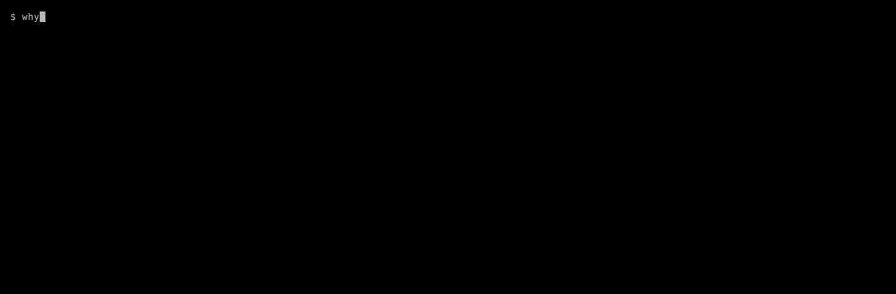

# whyfail

whyfail explains why a terminal command failed and suggests a fix, using a local LLM
through [Ollama](https://ollama.com). The command output never leaves your machine.



## Install

Download the archive for your system from the
[latest release](https://github.com/mbarboss/whyfail/releases/latest), extract it and put
`whyfail` (`whyfail.exe` on Windows) in a directory on your `PATH`.

| OS | Archive |
|---|---|
| Linux | `whyfail_<version>_linux_amd64.tar.gz` or `_linux_arm64.tar.gz` |
| macOS | `whyfail_<version>_darwin_arm64.tar.gz` (Apple silicon) or `_darwin_amd64.tar.gz` (Intel) |
| Windows | `whyfail_<version>_windows_amd64.zip` or `_windows_arm64.zip` |

```sh
# Linux and macOS
tar xzf whyfail_<version>_<os>_<arch>.tar.gz
mkdir -p ~/.local/bin && mv whyfail ~/.local/bin/
```

```powershell
# Windows (PowerShell)
Expand-Archive whyfail_<version>_windows_amd64.zip -DestinationPath "$env:LOCALAPPDATA\Programs\whyfail"
# Then add that folder to your user PATH.
```

The binaries are not signed by Apple or Microsoft. On macOS, a binary downloaded with a
browser is quarantined; allow it with `xattr -d com.apple.quarantine ~/.local/bin/whyfail`.

To check a download, compare it with `checksums.txt` from the same release, and verify that
it was built by this repository's release workflow with the
[GitHub CLI](https://cli.github.com):

```sh
sha256sum --check --ignore-missing checksums.txt        # Linux
shasum -a 256 --check --ignore-missing checksums.txt    # macOS
gh attestation verify whyfail_<version>_<os>_<arch>.tar.gz --repo mbarboss/whyfail
```

On Windows, compare `(Get-FileHash whyfail_<version>_windows_amd64.zip).Hash` with the line
in `checksums.txt`.

With Go 1.27 or later you can also build it from source:

```sh
go install github.com/mbarboss/whyfail/cmd/whyfail@latest
```

whyfail also needs Ollama and a model; see [Requirements](#requirements).

## Usage

Put the command after `--`. whyfail runs it, shows its output as it arrives, and explains
it only when it fails:

```sh
whyfail -- npm install
```

Or pipe the output of a command that already failed into whyfail. Include stderr (`2>&1`),
since that is where most errors go:

```sh
npm install 2>&1 | whyfail
```

Either way the answer looks like this:

```text
Cause: The Docker socket is not accessible to your user.

Your user is not in the docker group, so the operating system denies access to the
daemon.

Suggested fixes (review before running):

  1. Add your user to the docker group.
     sudo usermod -aG docker $USER
     Warning: runs with administrator privileges.

  2. Start a shell with the new group membership.
     newgrp docker
```

whyfail never runs the suggested commands on its own (see [Running a fix](#running-a-fix)).
They come from a language model, so read them before you run them. Commands that use
administrator privileges, run downloaded code (`curl ... | sh`, `bash -c "$(curl ...)"`, or a
script downloaded and then run), delete recursively, force-stop processes, discard Git
changes, write to disks or edit files in place get a warning line. So does a fix that
installs a package (pip, npm, pnpm, yarn, uv, gem, cargo, go) whose name appears in the
error output: that name may be a typo or text planted in the output, and anyone can publish
a package under it. Check the name and where it comes from before installing it.

The warnings match known patterns. A fix without a warning is not proven safe.

Only the last 200 lines (at most 16 KiB) of the output are sent to the model, and secrets
are removed first. whyfail replaces private keys, credentials in URLs, `Authorization`
headers, GitHub, GitLab, AWS, Slack, Stripe, Google, npm and PyPI tokens, JWTs, LLM API
keys and `password=`/`secret:`/`token=` style values with placeholders such as
`[REDACTED:github-token]`, and tells you on stderr what kinds it removed:

```text
whyfail: redacted 1 secret (url-credentials) before asking the model.
```

Redaction is pattern-based. It catches common formats, not every possible secret, so avoid
piping output that you know holds unusual credentials.

### Wrapping a command

- The command runs directly, without a shell, so pipes, redirections and shell built-ins
  are not available. To use them, wrap a shell yourself, for example
  `whyfail -- bash -c 'make 2>&1 | tee build.log'` or `whyfail -- pwsh -c 'Get-Item x'`.
- The command's output goes through a pipe rather than straight to the terminal, so some
  programs turn off colors or progress bars.
- Ctrl+C reaches the command as usual. An interrupted command is not explained.
- whyfail exits with the command's exit code, even when the explanation itself fails (for
  example, Ollama is not running), so wrapping a command does not change what scripts see.
  A command killed by a signal is reported as 128 plus the signal number, like a shell does.

### Running a fix

With `--apply`, whyfail offers to run one of the suggested fixes after the explanation:

```text
Run which fix? [1-2, Enter to skip]: 1

  sudo usermod -aG docker $USER
  Warning: runs with administrator privileges.
Type "yes" to run it with bash:
```

- The questions are asked on the terminal itself, so `--apply` works in pipe mode too. Without
  a terminal (in CI, cron or with `--json`) whyfail refuses `--apply` with exit code 2 before
  doing anything else.
- The default answer is no. A fix with a warning runs only after you type `yes`; any other fix
  also accepts `y`.
- The fix runs exactly as shown, through your shell: `bash -c`, `zsh -c`, `fish -c`,
  `pwsh -NoProfile -Command` (or `powershell`) or `cmd /d /s /c`. whyfail needs to know the
  shell, so pass `--shell` when it cannot be detected.
- A fix that contains a redacted placeholder such as `[REDACTED:github-token]` is not run, since
  it would use the placeholder instead of your secret. Edit it and run it yourself.
- A fix that still holds a placeholder such as `<branch-name>` gets a warning and is not run,
  since the shell would read `<` and `>` as redirections. Edit it and run it yourself.
- In pipe mode whyfail exits with the fix's exit code, or 0 when nothing ran. In wrapper mode
  it still exits with the wrapped command's code.
- `--apply` is a flag only, with no environment variable, so nothing runs because of a
  forgotten setting.

### JSON output

With `--json`, whyfail prints exactly one JSON object on one line to stdout, and nothing
else goes to stdout. There is no progress indicator. In wrapper mode the command's own
stdout and stderr go to stderr, so `whyfail --json -- make > result.json` captures only the
JSON. Notices for humans (redacted secrets, `--allow-remote`) still go to stderr.

```json
{"schemaVersion":1,"model":"gemma4:e4b","command":"make -j4","exitCode":2,
 "cause":"...","explanation":"...",
 "fixes":[{"command":"sudo apt install libssl-dev","description":"...",
           "warnings":["runs with administrator privileges"]}]}
```

- `command` and `exitCode` are `null` in pipe mode. `command` is redacted.
- When the wrapped command succeeds, the object has `exitCode` 0 and no `cause`.
- `warnings` is always an array, empty when the fix looks safe.
- Text from the model is stripped of escape and control characters, as in text mode.
- `schemaVersion` changes only when a field is removed or changes meaning.

Errors come in the same object, with an `error` field instead of the answer:

```json
{"schemaVersion":1,"model":"gemma4:e4b","command":null,"exitCode":null,
 "error":{"code":"ollama_unreachable","message":"cannot reach Ollama at ..."}}
```

| `error.code` | Meaning |
|---|---|
| `usage` | Bad flags or arguments, or nothing piped in |
| `invalid_config` | A flag or environment value failed validation |
| `empty_input` | The piped input was empty |
| `host_refused` | The Ollama host is not on this machine (see `--allow-remote`) |
| `host_unresolved` | The Ollama host name could not be resolved |
| `ollama_unreachable` | Ollama is not running at the host |
| `model_not_found` | The model is not installed |
| `timeout` | No answer within `--timeout` |
| `malformed_answer` | The model's answer was unusable |
| `interrupted` | Ctrl+C |
| `command_not_found` | Wrapper mode: the command does not exist |
| `cannot_run` | Wrapper mode: the command could not be started |
| `no_output` | Wrapper mode: the command failed without printing anything |
| `internal` | Anything else |

Exit codes are the same as in text mode. A flag error (such as an unknown flag) is reported
as JSON only when `--json` comes before it on the command line. `--version` always prints
text. `whyfail --json doctor` prints
`{"schemaVersion":1,"passed":false,"checks":[{"status":"fail","title":"...","fix":"..."}]}`.

### Exit codes

| Code | Meaning |
|---|---|
| Command's code | Wrapper mode: the command ran (explained or not) |
| 0 | Pipe mode: the failure was explained (and with `--apply`, no fix ran) |
| Fix's code | Pipe mode with `--apply`: the confirmed fix ran |
| 1 | Runtime error: Ollama unreachable, model missing, timeout, unusable answer, or a fix that could not run (pipe mode) |
| 2 | Usage or configuration error, non-loopback host without `--allow-remote`, empty input, or `--apply` without a terminal or a known shell |
| 126 | Wrapper mode: the command was found but could not be started (for example, no execute permission) |
| 127 | Wrapper mode: command not found |
| 130 | Interrupted (pipe mode) |

## Requirements

- [Ollama](https://ollama.com/download) 0.9.0 or later running locally, with a model pulled.

| OS | Install Ollama |
|---|---|
| Ubuntu / Debian | `curl -fsSL https://ollama.com/install.sh \| sh` |
| macOS | `brew install ollama` |
| Windows | `winget install Ollama.Ollama` |

Then pull the default model (6.6 GB download; runs well on a GPU with 8 GB of VRAM):

```sh
ollama pull gemma4:e4b
```

Run `whyfail doctor` to check the setup. It checks that the Ollama host is on this
machine, that Ollama is running and recent enough, and that the model is installed, and
prints a fix for each failed check:

```text
ok    Ollama host is on this machine (http://127.0.0.1:11434)
ok    Ollama 0.40.2 is running
FAIL  Model gemma4:e4b is not installed
      Fix: ollama pull gemma4:e4b
info  Environment: Linux (Ubuntu 24.04.1 LTS), amd64, shell bash
```

It exits with 0 when every check passes and 1 otherwise. Flags such as `--model` and
`--host` apply to it too.

On machines with less memory, `qwen3.5:4b` (3.3 GB) is a lighter alternative; select it
with `--model qwen3.5:4b` or `WHYFAIL_MODEL=qwen3.5:4b`. The first request after Ollama
starts takes longer while the model loads.

## Configuration

whyfail reads its settings from flags or environment variables (flags win). See
[`.env.example`](.env.example) for the full list.

| Flag | Variable | Default | Meaning |
|---|---|---|---|
| `--model` | `WHYFAIL_MODEL` | `gemma4:e4b` | Ollama model used for explanations |
| `--host` | `OLLAMA_HOST` | `http://127.0.0.1:11434` | Ollama server; the captured output is sent here |
| `--allow-remote` | (none) | off | Allow a host that is not on this machine |
| `--timeout` | `WHYFAIL_TIMEOUT` | `2m` | Maximum time to wait for an answer (1s to 10m) |
| `--json` | (none) | off | Print one JSON object instead of text (see [JSON output](#json-output)) |
| `--shell` | `WHYFAIL_SHELL` | detected | Shell to write fixes for, and to run them with `--apply`: `bash`, `zsh`, `fish`, `powershell` (or `pwsh`), `cmd` |
| `--apply` | (none) | off | Offer to run one fix after confirmation (see [Running a fix](#running-a-fix)) |

Along with the output, the model is told your OS, CPU architecture and shell, plus the
distribution name from `/etc/os-release` on Linux, so fixes use the right package manager
and syntax. The shell is the program that started whyfail; when that is not a shell (for
example `make` or `npm`), whyfail falls back to `$SHELL`, and otherwise reports it as
unknown. Set `--shell` when the detection is wrong.

`OLLAMA_HOST` accepts the same forms as the Ollama CLI, such as `127.0.0.1:11500`.
`0.0.0.0`, often set so the Ollama server listens on every interface, means this machine.

whyfail only talks to Ollama on this machine. A host that is not a loopback address, or a
name that resolves to anything other than loopback, is refused with exit code 2. The check
runs again on every connection, so DNS changes and redirects cannot send the output
elsewhere. To use Ollama on another machine, pass `--allow-remote` on each run; there is
no environment variable for it, so the choice is always explicit, and whyfail prints a
warning every time. whyfail also ignores `HTTP_PROXY` and `HTTPS_PROXY`.

## Development

You need Go 1.27 or newer and Git.

| OS | Install Go and Git |
|---|---|
| Ubuntu / Debian | `sudo apt install git` and Go from [go.dev/dl](https://go.dev/dl/) (the apt package is usually older than 1.27) |
| macOS | `brew install go git` |
| Windows | `winget install GoLang.Go Git.Git` |

Every development tool (golangci-lint, govulncheck, gitleaks, lefthook) is pinned in its
own module under `tools/` and runs through `go tool`, so there is nothing else to install.
All commands run from the repository root and work the same on every OS.

| Purpose | Command |
|---|---|
| Install git hooks (once) | `go run ./tools/task hooks` |
| Format code | `go run ./tools/task format` |
| Full check (tidy, format, lint, tests, vulnerabilities, secrets) | `go run ./tools/task check` |
| Tests with the race detector (need a C compiler, such as gcc, Xcode Command Line Tools or MinGW-w64; CI runs them on Linux) | `go run ./tools/task race` |
| Integration tests (need a running Ollama) | `go run ./tools/task integration` |
| Run locally | `<command> 2>&1 \| go run ./cmd/whyfail` |
| List all targets | `go run ./tools/task` |
| Re-record the demo GIF (needs [VHS](https://github.com/charmbracelet/vhs) with `ttyd` and `ffmpeg`, plus Ollama) | `vhs docs/demo.tape` |

The pre-commit hook formats staged Go files, runs the linters, scans staged changes for
secrets and rejects files larger than 1 MiB.

### Releasing

1. Move the `Unreleased` entries in `CHANGELOG.md` to a `## [X.Y.Z] - YYYY-MM-DD` section and
   merge that change.
2. Tag the merge commit on `main` and push the tag: `git tag vX.Y.Z` and
   `git push origin vX.Y.Z`.

The release workflow then runs the full check on all three OSes, builds the archives with
[GoReleaser](https://goreleaser.com) (`.goreleaser.yaml`), publishes them with the
`CHANGELOG.md` section as release notes, attests their provenance, and finally downloads the
published archives on Linux, macOS and Windows to run a smoke test
(`go run ./tools/task smoke <dir> <version>`).

## License

[MIT](LICENSE)
